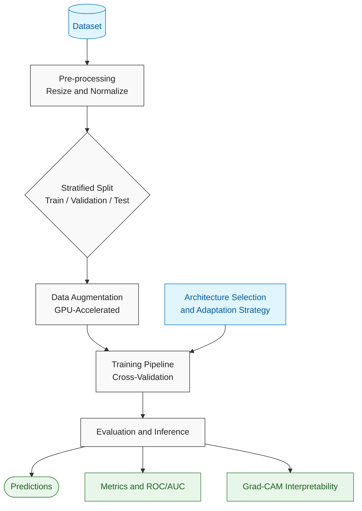

 <div align="center">

# Transfer Learning for Plant Disease Detection

**A Comparative Study of EfficientNetV2, MobileNetV4, ConvNeXtV2, and ViT-Base**

**Under Three Adaptation Regimes: Feature Extraction · Partial Fine-Tuning · Full Fine-Tuning**


Département d'Informatique · Faculté des Sciences Semlalia, Université Cadi Ayyad, Marrakech

Supervised by **Pr. Mustapha AATILA**

</div>

---

## Overview

Plant diseases inflict significant agricultural losses globally. Traditional manual diagnosis is labor-intensive, subjective, and difficult to scale. While Convolutional Neural Networks (CNNs) offer a promising automated solution, they typically require massive annotated datasets—a resource often scarce in agricultural domains.

This study investigates the following research question:

> **To what extent can Transfer Learning enhance plant disease classification, and which combination of architecture and adaptation strategy yields the optimal balance of accuracy, computational efficiency, and robustness?**

This project evaluates modern pre-trained architectures against a baseline CNN trained from scratch. To ensure scientific rigor, all models are evaluated under strictly identical training conditions, and model predictions are interpreted using Gradient-weighted Class Activation Mapping (Grad-CAM).

## Contributions

- A systematic comparison of state-of-the-art pre-trained architectures, encompassing both CNNs and Vision Transformers.
- An empirical study on the impact of fine-tuning depth across three distinct adaptation strategies.
- Comprehensive performance analysis across multiple plant disease classifications.
- Enhanced model interpretability through Grad-CAM visualizations.

## Experimental Design

| Axis | Configuration |
|---|---|
| **Models** | EfficientNetV2 · MobileNetV4 · ConvNeXtV2 · ViT-Base (Transformer) · Baseline CNN (trained from scratch) |
| **Adaptation Strategies** | Feature Extraction (frozen backbone) · Partial Fine-Tuning (unfreezing terminal blocks) · Full Fine-Tuning |
| **Dataset** | [Plant Leaf Diseases (Kaggle)](https://www.kaggle.com/datasets/moazawadali/plant-leaf-diseases) |
| **Evaluation Metrics** | Accuracy · Precision · Recall · F1-score · ROC / AUC · Confusion Matrix · Parameter Count · Training Duration |
| **Validation Method** | Train / Validation / Test stratification supplemented by k-fold cross-validation |
| **Explainability** | Grad-CAM (identifying diseased regions and detected morphological symptoms) |

> **Methodological Note:** All architectures are trained under identical hyperparameters (optimizer, learning rate, batch size, epoch count, data augmentation, and random seed) to guarantee a controlled and fair comparative analysis.

## Technical Architecture and Methodology

| Component | Technology Selection | Methodological Rationale |
|---|---|---|
| **Deep Learning Framework** | **TensorFlow 2 + Keras 3**, utilizing **KerasHub** (`keras-hub`) for pre-trained backbones | Keras callbacks facilitate a streamlined training loop; `tf.data` ensures optimized, high-throughput input pipelines. |
| **Computational Optimization** | `tf.data` (`cache`, `prefetch(AUTOTUNE)`), Keras mixed precision, XLA compilation (`jit_compile=True`) | Maximizes GPU utilization on constrained platforms (Google Colab/Kaggle), enabling comprehensive multi-run experiments. |
| **Data Processing & Augmentation** | `tf.data` + Keras preprocessing layers (`RandomFlip`, `RandomRotation`, `RandomZoom`, `RandomContrast`), scikit-learn (`StratifiedKFold`) | In-pipeline GPU-accelerated augmentation. Stratified splits ensure statistically representative cross-validation. |
| **Model Interpretability** | Grad-CAM implemented via `tf.GradientTape` | Provides verifiable symptom localization for CNNs. For ViT-Base, terminal transformer block patch tokens are reshaped into a spatial grid. |
| **Experiment Tracking** | Localized directory logging (`results/<run>/` containing `config.yaml`, `history.csv`, `metrics.json`) | Ensures self-contained, reproducible experiment logs without relying on external telemetry servers. |
| **Data Versioning** | **DVC** (Data Version Control) | Maintains a reproducible dataset and split manifest without bloating the version control repository with raw images. |
| **Configuration Management** | YAML + OmegaConf/Hydra | A unified `base.yaml` configuration enforces identical training parameters across all architectural variations. |
| **Demonstration Application** | **Gradio** deployed via Hugging Face Spaces | Provides an interactive interface for inference and real-time Grad-CAM overlay visualization. |
| **Model Exportation** | **TensorFlow Lite** (incorporating post-training quantization) | Evaluates deployment feasibility for mobile and edge devices by measuring true inference latency and memory footprint. |
| **Code Quality Assurance** | **SonarQube** | Automates static code analysis, ensuring security, maintainability, and standard compliance prior to academic submission. |

### Pre-trained Model Availability (TensorFlow/Keras Ecosystem)

| Architecture | Source Framework | Verification Status |
|---|---|---|
| **EfficientNetV2** | `keras.applications` or KerasHub presets | Official Support |
| **ViT-Base** | KerasHub (`vit_base_patch16_224_imagenet`) | Official Support |
| **ConvNeXtV2** | In-repo Keras 3 port ([`src/convnextv2.py`](src/convnextv2.py)) loading timm's `convnextv2_tiny.fcmae_ft_in1k` weights | Validated: features and logits match timm within 1e-3 ([`tests/test_convnextv2.py`](tests/test_convnextv2.py)) |
| **MobileNetV4** | Currently unavailable natively in TensorFlow/Keras | See fallback protocol below |

> **ConvNeXtV2 weights licence:** the official FAIR ConvNeXtV2 checkpoints are released under **CC-BY-NC-4.0** (non-commercial use only), which covers this academic study and a non-commercial demo.

> **Fallback Protocol for MobileNetV4:** Should MobileNetV4 weights remain unavailable in the TensorFlow ecosystem, **MobileNetV3-Large** will be substituted as the representative lightweight architecture. This substitution will be explicitly documented in the final manuscript.

### Methodological Safeguards for Comparative Rigor

- **Data Leakage Prevention:** Perceptual hashing is applied prior to dataset splitting to ensure augmented variations of identical samples do not cross-contaminate training, validation, and testing sets.
- **Controlled Comparisons:** Standardized input dimensions (224 × 224), deterministic seeding, and uniform augmentation parameters are enforced. Learning rates are independently optimized per architecture via a controlled hyperparameter sweep.
- **Strategy Definitions:**
  - *Feature Extraction:* Backbone frozen; BatchNorm layers locked in inference mode (`training=False`).
  - *Partial Fine-Tuning:* Terminal stages unfrozen (consistent proportional depth across models).
  - *Full Fine-Tuning:* All parameters set to trainable.
- **Statistical Significance:** Results are reported as mean ± standard deviation across multiple seeds. McNemar's test is applied to assess significance between top-performing models.
- **Class Imbalance Handling:** Evaluation prioritizes macro-F1 scores and per-class recall over aggregate accuracy.
- **Robustness Testing:** Accuracy is evaluated against synthetic corruptions (Gaussian blur, noise, contrast shifts) and out-of-distribution (OOD) field-condition imagery.

## Code Quality and Security Audit

This repository is subject to rigorous static analysis using **SonarQube** to ensure code maintainability and security. The quality gate must indicate a passing status prior to the final academic submission.

### Quality Gate Criteria

```text
SonarQube Quality Gate Requirements (New Code):

- 0 Blocker or Critical issues
- 0 Unreviewed Security Hotspots
- Code Duplication < 3%
```

### Security and Best Practices

- **Credential Management:** API tokens (Kaggle, Hugging Face) are strictly managed via environment variables and never committed to the repository.
- **Notebook Sanitization:** All Jupyter notebook outputs are stripped prior to version control (`nbstripout`) to prevent inadvertent data or path leakage.
- **Model Security:** Model checkpoints are saved in the secure `.keras` format.
- **Dependency Management:** All libraries are strictly pinned within a lockfile to ensure reproducible execution environments.

## Execution Workflow

The following diagram illustrates the complete experimental pipeline, from dataset ingestion to model evaluation and interpretability.



## Repository Structure

```text
.
├── README.md                 # Project documentation and execution instructions
├── requirements.txt          # Pinned dependencies
├── sonar-project.properties  # SonarQube configuration parameters
├── SECURITY.md               # Vulnerability reporting guidelines
├── configs/                  # Experiment configurations (YAML)
│   └── base.yaml             # Shared hyperparameters
├── data/                     # Local dataset directory (git-ignored)
├── src/
│   ├── datasets.py           # Data ingestion, deduplication, and augmentation pipelines
│   ├── models.py             # Architecture initializations (KerasHub / custom CNN)
│   ├── strategies.py         # Freezing and fine-tuning logic
│   ├── train.py              # Primary training loop and checkpoint management
│   ├── evaluate.py           # Metric computation and visualization
│   ├── robustness.py         # Out-of-distribution and perturbation testing
│   ├── benchmark.py          # Profiling (FLOPs, Latency, Memory)
│   └── gradcam.py            # Interpretability implementations
├── app/
│   └── app.py                # Gradio application interface
├── scripts/
│   └── export_tflite.py      # Edge deployment conversion and quantization
├── notebooks/                # Exploratory Data Analysis (EDA)
├── results/                  # Structured experiment telemetry and logs
├── paper/                    # Final academic manuscript and citations
└── CONTRIBUTIONS.md          # Detailed team contribution matrix
```

## Setup and Execution Guide

### Running the Notebooks on a Colab GPU from VS Code

With the [Colab extension for VS Code](https://marketplace.visualstudio.com/items?itemName=Google.colab), the notebook stays on your machine but its code runs on a Google VM that cannot see your local files. The first code cell of every notebook handles this: on a Colab kernel it clones the repository into `/content/plant-disease-tl`, installs [`requirements-colab.txt`](requirements-colab.txt) and downloads the dataset ([`src/colab.py`](src/colab.py)). On a local kernel it only locates the project root.

**No tokens are needed.** The repository is public, and the dataset is downloaded anonymously through `kagglehub`. Optional settings, read from environment variables or Colab Secrets:

| Variable | Effect |
|---|---|
| `KAGGLE_API_TOKEN` | Downloads through the Kaggle CLI instead, which also records the archive SHA-256 in `data/provenance.json` |
| `MLFLOW_TRACKING_URI` (+ `_USERNAME`, `_PASSWORD`) | Logs to a shared MLflow server, so runs outlive the VM and the whole team sees them |

Never paste a token into a notebook cell, and keep local secrets in `.env` (git-ignored), not in `.env.example`.

**Every session**

1. Commit and **push** your changes: the Colab VM only sees what is on GitHub.
2. Set `BRANCH` in the first cell to your branch, then run it. It prints the commit it is running.
3. Without a remote `MLFLOW_TRACKING_URI`, `results/` and `mlflow.db` live on the VM and are deleted when the runtime is recycled, so copy them elsewhere before disconnecting.

### 1. Clone the Repository

```bash
git clone https://github.com/<ORG_NAME>/<REPO_NAME>.git
cd <REPO_NAME>
```

### 2. Initialize a Virtual Environment

```bash
python -m venv .venv
source .venv/bin/activate
```

For Windows:

```powershell
python -m venv .venv
.venv\Scripts\activate
```

### 3. Install Required Dependencies

```bash
pip install -r requirements.txt
```

### 4. Ingest the Dataset

Requires Kaggle API credentials.

```bash
kaggle datasets download -d moazawadali/plant-leaf-diseases -p data/ --unzip
```

### 5. Execute an Experimental Training Run

```bash
python -m src.train --config configs/base.yaml \
    --model efficientnetv2 \
    --strategy partial_ft
```

Available strategies:

- `feature_extraction`
- `partial_ft`
- `full_ft`

### 6. Evaluate Model Performance and Generate Visualizations

```bash
python -m src.evaluate --run results/efficientnetv2_partial_ft
```

### 7. Generate Grad-CAM Interpretability Maps

```bash
python -m src.gradcam --run results/efficientnetv2_partial_ft --n 12
```

### 8. Conduct Benchmarking and Robustness Evaluations

```bash
python -m src.benchmark --run results/efficientnetv2_partial_ft

python -m src.robustness --run results/efficientnetv2_partial_ft
```

## Empirical Results

*Status: ConvNeXtV2 complete (single seed). The other architectures are pending; EfficientNetV2 is being re-run on the cleaned dataset. Tables are updated as experiments conclude.*

**Setup.** Cleaned dataset of 34,481 images (21 classes) after removing 420 images from near-duplicate groups with conflicting labels and 5,322 redundant near-duplicates; group-stratified split of 24,135 train / 5,172 validation / 5,174 test images. Seed 42, mixed precision, hyperparameters from [`configs/base.yaml`](configs/base.yaml), trained on an NVIDIA RTX 3070 (8 GB). All metrics are computed on the held-out test set; precision, recall and F1 are macro-averaged, AUC is macro one-vs-rest.

### Classification Performance

| Architecture | Strategy | Accuracy | Precision | Recall | F1-Score | AUC | Trainable / Total Params | Epochs | Training Duration |
|---|---|---|---|---|---|---|---|---|---|
| Baseline CNN | From scratch | – | – | – | – | – | – | – | – |
| EfficientNetV2 | All strategies | – | – | – | – | – | – | – | – |
| MobileNetV4 | All strategies | – | – | – | – | – | – | – | – |
| ConvNeXtV2-T | Feature extraction | 0.8846 | 0.8953 | 0.9077 | 0.8989 | 0.9950 | 17.7K / 27.9M | 15 † | 11 min |
| ConvNeXtV2-T | Partial fine-tuning | 0.9718 | 0.9742 | 0.9755 | 0.9746 | 0.9997 | 7.1M / 27.9M | 30 † | 25 min |
| ConvNeXtV2-T | **Full fine-tuning** | **0.9867** | **0.9855** | **0.9877** | **0.9865** | **0.9997** | 27.9M / 27.9M | 18 | 35 min |
| ViT-Base | All strategies | – | – | – | – | – | – | – | – |

† Reached the epoch budget for that strategy without early stopping, so further training might still improve it; the budget is identical across architectures.

**ConvNeXtV2 observations.** Adaptation depth drives performance: test macro-F1 rises from 0.899 with a frozen backbone to 0.975 when the last 25% of parameters are tuned, and to 0.987 with full fine-tuning. Calibration improves in the same order (expected calibration error 0.035 → 0.013 → 0.010), and top-3 accuracy reaches 0.999 with full fine-tuning. Full fine-tuning costs about 3× the training time of feature extraction and early-stopped after 18 of 40 epochs.

### Computational Efficiency and Robustness

| Architecture | FLOPs | CPU Latency (ms) | TFLite Footprint (MB) | Perturbation Accuracy (Blur/Noise) | OOD Accuracy |
|---|---|---|---|---|---|
| EfficientNetV2 | – | – | – | – | – |
| MobileNetV4 | – | – | – | – | – |
| ConvNeXtV2 | – | – | – | – | – |
| ViT-Base | – | – | – | – | – |

## Interpretability

Grad-CAM analysis is applied to validate that the models' predictive capabilities are grounded in legitimate botanical pathology (e.g., lesions, chlorosis) rather than spurious background artifacts or systemic biases within the dataset.

## Interactive Demonstration

A web-based interface (hosted via Hugging Face Spaces) has been developed to allow external validation of the models.

The application processes uploaded botanical imagery to output:

- Disease classifications.
- Confidence distributions.
- Corresponding Grad-CAM spatial heatmaps.

*Link to be provided upon deployment.*

## Limitations and Future Work

- **Current Limitations:** The primary dataset relies heavily on controlled-environment imagery, which may constrain generalization to in-situ agricultural contexts.
- **Future Perspectives:** Subsequent research should explore multimodal data integration (e.g., environmental sensors alongside optical data), deployment optimization for low-power edge devices, and real-time drone-based inference pipelines.

## Deliverables Checklist

- [ ] Original codebase and implementation.
- [ ] Documented version control repository adhering to standard formatting and security practices.
- [ ] Passing SonarQube quality gate.
- [ ] Academic manuscript formatted to program specifications.
- [ ] Itemized team contribution matrix.

## Research Team

| Name | Primary Responsibilities |
|---|---|
| Student 1 | *To be documented* |
| Student 2 | *To be documented* |
| Student 3 | *To be documented* |
| Student 4 | *To be documented* |

## References

*The complete bibliography is maintained within `paper/references.bib` using standard academic citation formats.*

---

<div align="center">

<sub>Master ISI S3 · Deep Learning (Transfer Learning) · FSSM, Université Cadi Ayyad · Academic Year 2026–2027</sub>

</div>
